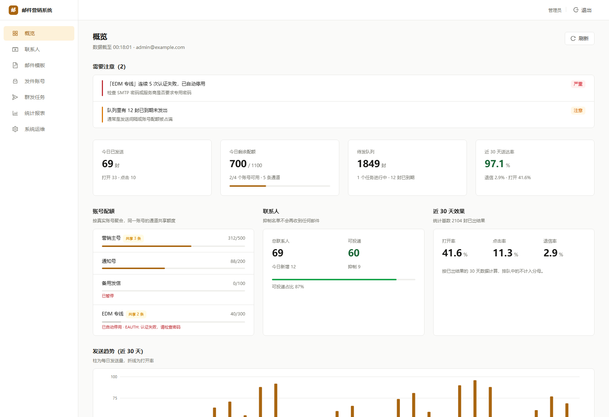
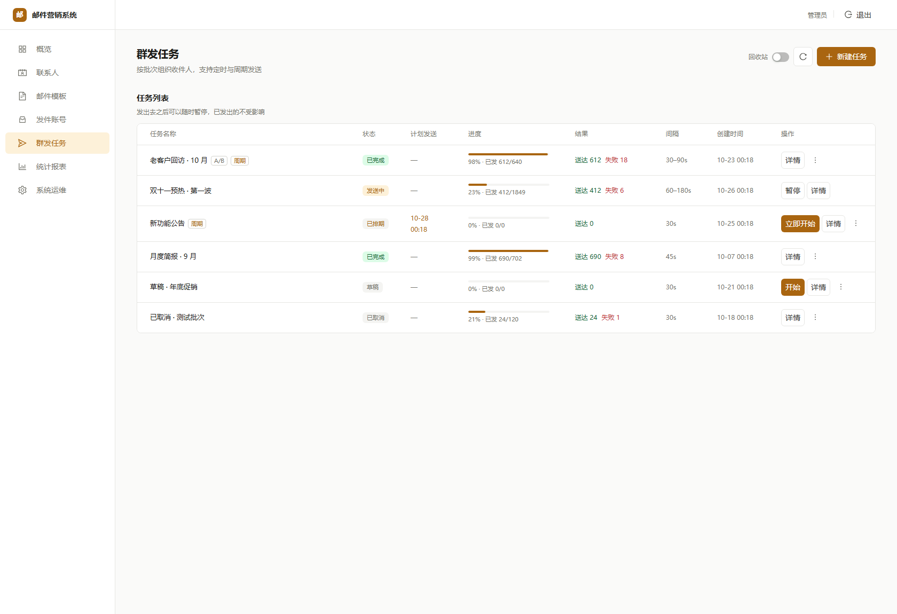
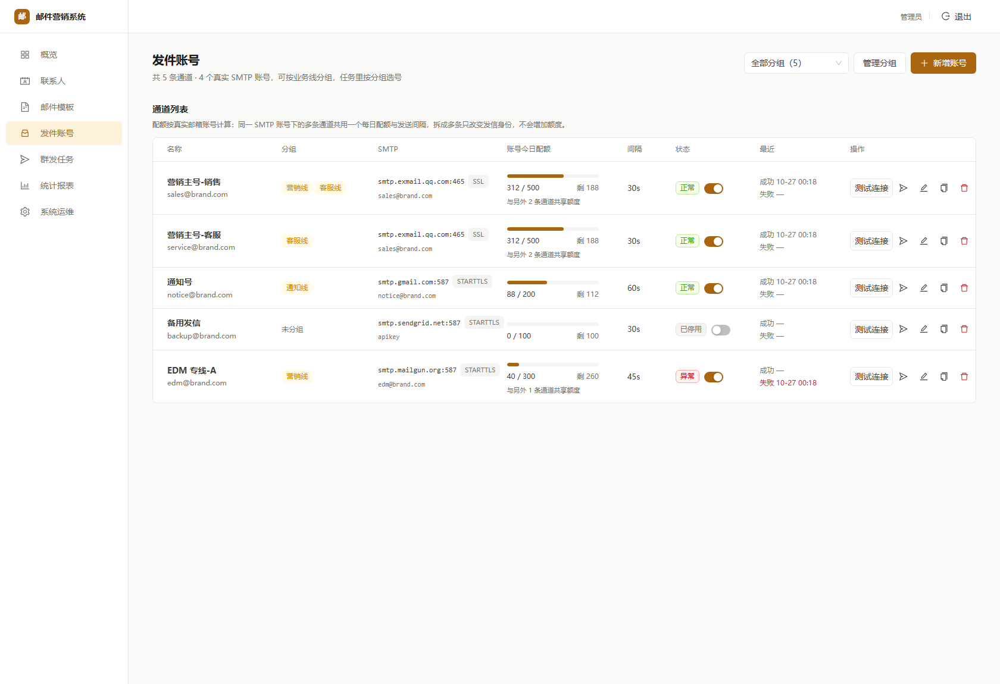
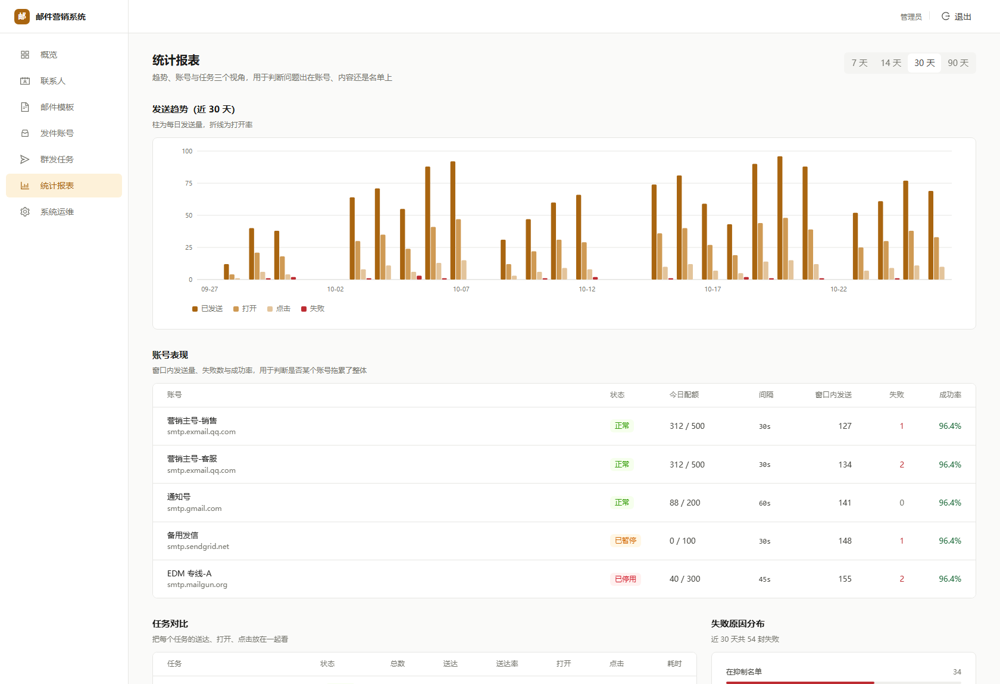
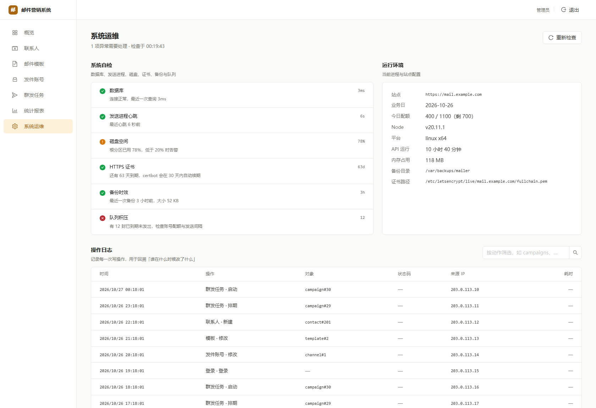

# 邮件营销系统

自托管的批量邮件发送系统：联系人 → 模板 → 群发任务 → 追踪统计 → 运维自检。
发信走你自己的 SMTP 账号，收件人数据只存在你自己的数据库里，不经过任何第三方营销平台。



## 它解决什么问题

把邮箱导进表格、手动群发、再靠人盯打开率，是最常见的做法，也是最容易把域名信誉做坏的做法。
这套系统把「发多少、隔多久、发给谁、有没有退信」变成可配置、可追溯的流程：

- **配额按发件邮箱算**，一条记录就是一个发信地址，各自的每日上限与已发数互不影响
- **发送间隔按任务设置**，支持最小~最大随机区间，避免整点整齐成批发信（那是最容易被判定为群发的特征）
- **地址不存在自动停发**：硬退信的地址被拉黑，并从原分组移到「地址不存在」分组，同一个死地址不会被反复撞
- **每步都留痕**：谁在什么时候改了任务、清了日志、换了密码

## 功能

| 模块 | 说明 |
|---|---|
| 发件账号 | 多个 SMTP 发件邮箱 + 常用服务商预设，可按业务线分组；每个邮箱独立配额与状态 |
| 联系人 | 分组（删除分组连同组内联系人一起删、可单独清空）、自定义字段、批量删除、CSV/XLSX/XLS/TXT 导入（GBK 自动识别、无表头自动定位邮箱列）、导入任务可暂停续传 |
| 邮件模板 | 富文本与 HTML 双模式、变量替换、附件、预览与测试发送 |
| 群发任务 | 四步向导、定时发送、周期重复、A/B 变体、暂停/继续/取消、投递明细下钻 |
| 发送引擎 | 原子取件、按任务节奏串行发送、4xx 退避重试、5xx 判死停发（地址不存在自动归组）、连续失败熔断 |
| 追踪统计 | 打开像素、点击跳转（目标地址参与签名，防开放重定向）、任务/账号/时间三维报表、失败归因 |
| 系统运维 | 自检（数据库、发送进程心跳、磁盘、证书、备份、队列）、操作审计、管理员账号与密码自助修改 |

<p align="center">
  
  
</p>
<p align="center">
  
  
</p>

## 快速开始（Docker Compose）

需要 Docker 20+ 与 Docker Compose v2（`docker compose version` 能输出版本即可）。
镜像托管在 ghcr.io，**部署不需要克隆本仓库**——只要两个文件。

### 1. 拿部署文件

```bash
mkdir mailer && cd mailer
curl -O https://raw.githubusercontent.com/misakacoo/mailer/main/docker-compose.yml
curl -o .env https://raw.githubusercontent.com/misakacoo/mailer/main/docker/.env.example
```

### 2. 编辑 .env

至少改这两项：

| 变量 | 说明 |
|---|---|
| `DB_PASSWORD` | 数据库密码，`openssl rand -hex 24` 生成一个 |
| `APP_URL` | 面板对外地址，必须带协议。**还没配反向代理、想先本地跑起来看看？填 `http://127.0.0.1:8080`**，其余以后再调 |

### 3. 启动

```bash
docker compose up -d
```

首次启动自动完成三件事：生成密钥（写入 `data` 卷）→ 建表并跑迁移 → 创建管理员账号。盯一下进度：

```bash
docker compose ps          # 四个服务都是 Up / healthy 即就绪
docker compose logs -f api # 看到「已创建管理员账号：admin」即可，Ctrl-C 退出
docker compose logs api | grep -A2 随机管理员密码   # 没设 ADMIN_PASSWORD 时，密码在这里
```

### 4. 打开面板

- 没配反代时：`http://127.0.0.1:8080`（API 在 `http://127.0.0.1:3000`）
- 两者都只绑 `127.0.0.1`，公网直接访问不到——对外服务请接反向代理，见下文

### 首次登录

首次启动会创建管理员账号 `admin`，密码来源取决于 `.env`：

- **没填 `ADMIN_PASSWORD`（推荐）**：自动生成 20 位随机密码，只打印这一次，
  用 `docker compose logs api | grep -A2 随机管理员密码` 找出来存好
- **填了 `ADMIN_PASSWORD`**：就是它

用自动生成的密码登录后，面板会强制你先改密码，改完才能进其他页面——所以拿到日志后第一步就是换成自己的。

> 这套系统能对外发信，管理员口令等于发信权。别把 `.env` 或容器日志贴到公开的地方。

### 想基于源码部署？

也可以克隆完整仓库后在其中 `docker compose up -d`（compose 与 env 模板在仓库根目录），效果与上面完全相同：

```bash
git clone https://github.com/misakacoo/mailer.git
cd mailer
cp docker/.env.example .env    # 同样至少改 DB_PASSWORD 与 APP_URL
docker compose up -d
```

### 接上反向代理

容器只监听 `127.0.0.1`，需要把域名指进来。nginx 示例：

```nginx
server {
    listen 443 ssl http2;
    server_name mail.example.com;

    ssl_certificate     /etc/letsencrypt/live/mail.example.com/fullchain.pem;
    ssl_certificate_key /etc/letsencrypt/live/mail.example.com/privkey.pem;

    client_max_body_size 25m;          # 与导入上限一致

    location /api/ {
        proxy_pass http://127.0.0.1:3000;
        proxy_set_header Host $host;
        proxy_set_header X-Real-IP $remote_addr;
        proxy_set_header X-Forwarded-For $proxy_add_x_forwarded_for;
        proxy_set_header X-Forwarded-Proto $scheme;
    }

    # 打开追踪，注意末尾的 /api/t/ 不能少
    location /t/ {
        proxy_pass http://127.0.0.1:3000/api/t/;
        proxy_set_header Host $host;
        proxy_set_header X-Real-IP $remote_addr;
        proxy_set_header X-Forwarded-For $proxy_add_x_forwarded_for;
    }

    location / {
        proxy_pass http://127.0.0.1:8080;
        proxy_set_header Host $host;
        proxy_set_header X-Real-IP $remote_addr;
        proxy_set_header X-Forwarded-For $proxy_add_x_forwarded_for;
        proxy_set_header X-Forwarded-Proto $scheme;
    }
}
```

Caddy 会自动申请证书：

```
mail.example.com {
    handle /api/* { reverse_proxy 127.0.0.1:3000 }
    handle /t/*   { reverse_proxy 127.0.0.1:3000 }
    handle        { reverse_proxy 127.0.0.1:8080 }
}
```

`APP_URL` 必须与实际访问地址一致（含协议）。填 `https://` 时会话 Cookie 才会带 `Secure`。

## 配置

| 变量 | 必填 | 说明 |
|---|---|---|
| `DB_PASSWORD` | 是 | 数据库密码，`openssl rand -hex 24` 生成一个 |
| `APP_URL` | 是 | 面板对外地址，如 `https://mail.example.com` |
| `ADMIN_EMAIL` | 否 | 初始账号，默认 `admin`，仅首次写库时使用 |
| `ADMIN_PASSWORD` | 否 | 初始密码，仅首次写库时使用；**留空则随机生成并打印到容器日志** |
| `API_PORT` / `WEB_PORT` | 否 | 宿主机回环端口，默认 3000 / 8080 |

其余密钥（`CRED_KEY`、`JWT_SECRET`、密码哈希）由容器首次启动生成，写在 `data` 卷的 `secrets.env`。

镜像版本通过 `.env` 里的两个变量控制，见下一节。

## 三条不能碰的

1. **不要更换 `CRED_KEY`** —— 它是 SMTP 密码的唯一解密密钥，换了库里所有凭据永久失效。
2. **不要用 `prisma migrate dev` / `migrate reset`** —— 前者要建影子库，后者清空数据。只用 `migrate deploy`。
3. **备份不含密钥** —— 数据库备份里只有密文，`CRED_KEY` 必须单独保存；容器部署下它在 `data` 卷里。

## 版本与升级

镜像默认 `latest`（跟随 main）。**生产环境建议钉到具体版本**，避免某次 `docker compose pull` 把线上换成没测过的构建——在 `.env` 里加两行：

```bash
MAILER_IMAGE=ghcr.io/misakacoo/mailer:v1.1.3
MAILER_WEB_IMAGE=ghcr.io/misakacoo/mailer-web:v1.1.3
```

升级就是改这两个值再重建：

```bash
# 发新版本后，只改版本号再重建（下面以升到 v1.2.0 为例）：
sed -i 's#^MAILER_IMAGE=.*#MAILER_IMAGE=ghcr.io/misakacoo/mailer:v1.2.0#' .env
sed -i 's#^MAILER_WEB_IMAGE=.*#MAILER_WEB_IMAGE=ghcr.io/misakacoo/mailer-web:v1.2.0#' .env
docker compose pull && docker compose up -d
```

数据库迁移在 api 容器启动时自动执行（`RUN_MIGRATIONS`），`worker` 会等 api 健康后再起，所以直接 `up -d` 就是安全的顺序。

## 数据与备份

| 内容 | 位置 |
|---|---|
| 数据库 | Docker 卷 `pgdata` |
| 密钥、附件、导入暂存 | Docker 卷 `data` |
| 备份 | 建议 cron：`docker compose exec -T postgres pg_dump -Fc -U mailer mailer > backup-$(date +%F).dump` |

两个卷必须一起备份——只有数据库没有 `CRED_KEY`，恢复出来的 SMTP 密码是一堆解不开的密文。

```bash
docker compose down        # 可以
docker compose down -v     # 绝对不要：会把密钥卷一起删掉
```

## 架构

```
反向代理（你的）──┬─→ web 容器 :8080    前端静态文件
                 └─→ api 容器 :3000    REST
                          │
                     postgres 容器     仅内网
                          │
                     worker 容器       发送队列 + 定时调度 + 退信轮询
```

`api` 与 `worker` 是**同一个镜像**，只有 `command` 不同。发送是长连接密集的活，与 HTTP 服务分开跑，重启面板不会打断正在发送的批次。

## 本地开发

需要 Node 22、pnpm 9 与 PostgreSQL 14+。

```bash
cd app
pnpm i
cp ../deploy/mailer.env.example apps/api/.env     # 填 DATABASE_URL 与密钥
pnpm prisma:generate
pnpm --filter @mailer/api exec prisma migrate deploy
pnpm dev:api          # 后端；另开终端跑 worker：pnpm --filter @mailer/api dev:worker
pnpm dev:web          # 前端，默认 5173，已配 /api 代理
```

生产构建 `pnpm -r build`（先 api 后 web）。

## 目录

```
app/apps/api/          后端：REST + 发送 worker（同模块两个入口）
app/apps/api/prisma/   数据模型与迁移
app/apps/web/          前端面板
docker/                镜像相关：entrypoint、web 的 nginx 配置、环境变量模板
deploy/                裸机部署脚本（systemd + nginx + 备份/恢复）
docs/                  部署指南、运维手册、界面截图
```

不用 Docker 也可以裸机部署，见 [docs/部署指南.md](docs/部署指南.md)；日常运维与排障见 [docs/运维手册.md](docs/运维手册.md)。

## 已知边界

- **单管理员**：个人/小团队自用工具，没有多租户、角色与团队协作。
- **附件只存本地卷**，不接对象存储。
- **退信依赖 IMAP**：服务商不提供 IMAP 时只能靠 SMTP 同步错误捕获，判死会滞后。
- **不内置 TLS**：证书交给你的反向代理，这样更容易塞进已有基础设施。

## 许可

MIT
